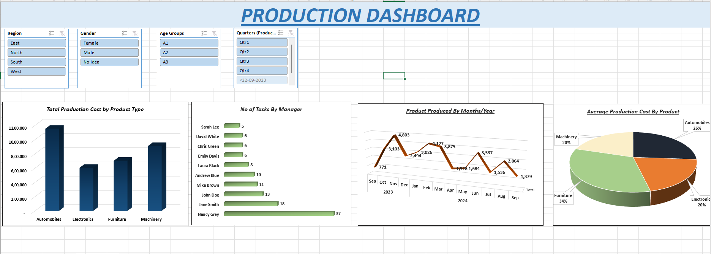

# 📊 Production Dashboard (Excel)

An interactive Excel dashboard that analyzes manufacturing production data using **PivotTables, PivotCharts and slicers**. It shows production cost, output and manager workload across product types, regions and time, and lets users filter every chart at once.


<!-- Add a screenshot of the Dashboard sheet named Dashboard.png to this repo -->

---

## 📌 Project Overview

| Property | Details |
|---|---|
| **Project name** | Production Dashboard |
| **File** | `Pivot_and_slicers.xlsx` |
| **Tool** | Microsoft Excel |
| **Techniques** | PivotTables, PivotCharts, Slicers, Calculated columns, IF logic |
| **Records** | 120 production entries |
| **Period covered** | 22 Sep 2023 to 14 Sep 2024 |
| **Sheets** | Dashboard, Production Data, Pivot 1 to Pivot 4 |

## 🎯 Objectives

- Compare production cost across product types
- Find which products have the highest cost per unit
- Track how many production tasks each manager handles
- Monitor units produced month by month
- Let users explore the data by region, gender, age group and quarter

---

## 🗂️ Dataset (`Production Data` sheet)

| Column | Description |
|---|---|
| `ProductionID` | Unique record number (1 to 120) |
| `ProductionDate` | Date of production |
| `Region` | North, South, East, West |
| `Manager` | Manager responsible (10 managers) |
| `ProductType` | Automobiles, Electronics, Furniture, Machinery |
| `UnitsProduced` | Number of units produced |
| `TotalCost` | Total production cost |
| `Gender` | Male, Female, No Idea |
| `True Age` | Age of the person (25 to 57) |
| `Age Groups` | **Calculated:** `=IF(I2<=35,"A1",IF(I2<=45,"A2","A3"))` |
| `Production Cost Per Unit` | **Calculated:** `=G2/F2` |

**Age group rules:** A1 = 35 and under, A2 = 36 to 45, A3 = 46 and over.

---

## 📈 Dashboard Components

### PivotTables and charts

| Sheet | Pivot | Chart | Purpose |
|---|---|---|---|
| Pivot 1 | Sum of TotalCost by ProductType | 3D bar chart: *Total Production Cost by Product Type* | Where the money is spent |
| Pivot 2 | Count of records by Manager | 3D bar chart: *No of Tasks By Manager* | Manager workload |
| Pivot 3 | Sum of UnitsProduced by Year and Month | Chart: *Product Produced By Months/Year* | Output trend over time |
| Pivot 4 | Average Production Cost Per Unit by ProductType | 3D pie chart: *Average Production Cost By Product* | Efficiency by product |

### Slicers (filter all charts together)

- **Region**
- **Gender**
- **Age Groups**
- **Quarters (ProductionDate)**

---

## 🔍 Key Findings

**Totals:** 34,727 units produced at a total cost of 3,371,078.

**Cost by product type**

| Product Type | Total Cost | Avg Cost per Unit | Records |
|---|---|---|---|
| Automobiles | 1,152,805 | 140.87 | 46 |
| Machinery | 910,416 | 108.98 | 30 |
| Furniture | 703,282 | 180.44 | 19 |
| Electronics | 604,575 | 108.37 | 25 |

- Automobiles has the highest total cost, while Furniture has the highest average cost per unit.
- The overall average cost per unit is about 132.39 (the average of the per-record values).

**By region**

| Region | Records | Units | Total Cost |
|---|---|---|---|
| West | 55 | 16,523 | 1,644,662 |
| North | 28 | 8,037 | 890,472 |
| South | 18 | 5,284 | 506,450 |
| East | 19 | 4,883 | 329,494 |

**Manager workload:** Nancy Grey handles the most tasks (37 of 120), followed by Jane Smith (18) and John Doe (13).

**Monthly output:** The busiest month was November 2023 with 4,803 units. 2023 (Sep to Dec) totals 11,171 units and 2024 (Jan to Sep) totals 23,556 units.

---

## 🛠️ How to Use

1. Download `Pivot_and_slicers.xlsx` and open it in Microsoft Excel (desktop version recommended, since slicers work best there).
2. Go to the **Dashboard** sheet.
3. Click any slicer button (Region, Gender, Age Groups, Quarters) to filter the charts. Hold **Ctrl** to select multiple values.
4. Use the **clear filter** icon at the top right of a slicer to reset it.
5. To refresh after changing the data, go to **Data → Refresh All**.

---

## 🧠 Skills Demonstrated

- Data preparation and calculated columns
- PivotTables and PivotCharts
- Slicers and interactive dashboard design
- Business-oriented analysis of cost, output and workload

---

## 📁 Repository Structure

```
Prism / Production-Dashboard
├── Pivot_and_slicers.xlsx   # Excel workbook with data, pivots and dashboard
├── Dashboard.png            # Screenshot of the dashboard
└── README.md                # Project documentation
```

---

## 👤 Author

**Zakariya Gezali**, Data Analyst
📫 [gezalizakariya94@gmail.com](mailto:gezalizakariya94@gmail.com) · 🐙 [GitHub](https://github.com/gezali)
